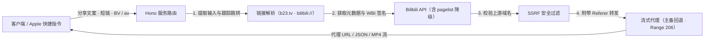

<div align="center">


<h1>bdownloader · Bilibili 视频解析与代理下载</h1>

<p>基于 <strong>Hono</strong> 构建的跨运行时 Bilibili 视频解析与流式代理服务，配套可自更新的 Apple 快捷指令。</p>

[](https://github.com/fwqaaq/icloudBili/actions/workflows/deploy.yaml)


<p>
  <a href="#核心特性与架构">核心架构</a> ·
  <a href="#部署指南">快速部署</a> ·
  <a href="#环境变量配置">环境变量</a> ·
  <a href="#api-接口说明">API 文档</a> ·
  <a href="#apple-快捷指令与网页引导">快捷指令</a>
</p>

</div>

---

## 核心特性与架构

`bdownloader`（仓库名 `icloudBili`）将原 iCloud 快捷指令的视频解析逻辑迁移至服务端，支持部署到 **Cloudflare Workers**、**Docker / NAS**、**Node.js 24+** 与 **Deno**。服务内置指纹签名、防盗链代理与主备节点回退，并提供配套的快捷指令引导页与在线测试面板。

### 核心特性

| 能力维度 | 实现说明 |
| --- | --- |
| **全格式输入解析** | 自动从 B 站 App 分享文案提取地址，兼容标准网页链接（含 `.html` 后缀）、`b23.tv` 与 `bili2233.cn` 短链重定向、`bilibili://` Scheme、裸 `BV` 号、裸 `av` 号及 `?p=` 分 P 参数。 |
| **WBI 签名与风控降级** | 自动获取 `spi`（`buvid3` / `buvid4`）指纹与 WBI（Web Interface，网页接口签名）密钥并缓存。遇上游风控拦截时，依次降级 `/x/player/pagelist` 与普通播放接口。 |
| **防盗链流式代理** | `/api/proxy` 附带 `Referer: https://www.bilibili.com/` 转发视频流，依次尝试主链接与 `backup_url` 备用 CDN（Content Delivery Network，内容分发网络）节点，支持 `Range` / `206` 断点续传与 `HEAD` 请求。 |
| **SSRF 与访问鉴权** | 禁止代理任意外部 `url=` 参数，过滤内网主机与 IP 字面量，防范 SSRF（Server-Side Request Forgery，服务端请求伪造）。可选配置 `API_TOKEN` 与 `ADMIN_TOKEN`。 |
| **快捷指令生态闭环** | 首页 `GET /` 提供安装引导、覆盖替换提示、网页测试与管理弹窗；仓库内附 [shortcuts/bilibili.cherri](shortcuts/bilibili.cherri) 源码，支持启动自动检查更新。 |

### 请求与代理流程



> [!WARNING]
> **节点风控与清晰度限制**：Cloudflare Workers 位于海外边缘节点，部分 Bilibili 接口或 CDN 节点可能因机房 IP 返回 `403`、`412` 或 `567` 拦截；此外 Workers 环境无法运行 `ffmpeg`，仅支持单流 MP4 输出（未登录通常最高 `720P`，配置 `SESSION` 后部分视频支持 `1080P`）。若频繁遇到节点拦截，推荐改用下方的 Docker Compose 或本地 Node.js 方式部署在国内网络环境中。

---

## 部署指南

### 方案对比

| 部署方式 | 适用场景 | 抗风控能力 | 网页端在线修改 `shortcut.json` | 配置文件 |
| --- | --- | --- | --- | --- |
| **Docker Compose** | NAS、国内云服务器（推荐） | 高（本地直连 IP） | 支持 | [docker-compose.yml](docker-compose.yml) |
| **Cloudflare Workers** | 零运维免费边缘托管 | 中（海外机房 IP） | 不支持（需改配置后重部署） | [wrangler.jsonc](wrangler.jsonc) |
| **Node.js 24+ / Deno** | 本地调试、轻量常驻进程 | 高（本地直连 IP） | 支持 | [scripts/serve-node.ts](scripts/serve-node.ts) |

### Docker Compose 部署（推荐国内网络）

镜像基于 `node:24-alpine` 构建，直接运行 TypeScript 源码并内置 `/api/health` 健康检查，默认监听 `8787` 端口：

```bash
cp .dev.vars.example .env
docker compose up -d --build
```

若宿主机 `8787` 端口已被占用，可在 `.env` 中修改 `HOST_PORT=8686`。启动后可通过 `curl` 验证服务状态：

```bash
curl -sG --data-urlencode "bilibili=https://www.bilibili.com/video/BV1q3yyzUEiD/" \
  "http://localhost:8787/api/download"
```

### Cloudflare Workers 部署

**（1）使用 Wrangler CLI 手动部署**

```bash
pnpm install
npx wrangler login
npx wrangler deploy
```

如需开启 `1080P` 单流支持或接口鉴权，通过 Wrangler Secrets 注入密钥（切勿将密钥提交至代码仓库）：

```bash
# 填入 Bilibili Cookie 中的 SESSDATA（可选）
npx wrangler secret put SESSION

# 启用 API 访问令牌（可选，配置后请求需带 ?token= 或 Authorization: Bearer <token>）
npx wrangler secret put API_TOKEN
```

**（2）使用 GitHub Actions 自动部署**

仓库中的 [deploy.yaml](.github/workflows/deploy.yaml) 已配置好类型检查、单元测试与自动部署流程。前往 GitHub 仓库的 `Settings -> Secrets and variables -> Actions`，添加以下两项机密：

- `CLOUDFLARE_API_TOKEN`
- `CLOUDFLARE_ACCOUNT_ID`

此后每次推送到 `main` 分支，工作流会自动运行校验并部署 Worker `bdownloader`。

### 本地运行与开发

复制环境变量模板文件（按需填入 `SESSION`、`API_TOKEN` 或 `ADMIN_TOKEN`）：

```bash
cp .dev.vars.example .dev.vars
```

项目支持三种本地启动方式（均默认监听 `8787` 端口，Node.js 与 Deno 会依次读取 `.env`、`.dev.vars` 与系统环境变量）：

```bash
# 1. 本地 Node.js（推荐用于国内直连环境，需 Node.js 24+）
pnpm dev:node

# 2. 本地 Deno
pnpm dev:deno

# 3. Cloudflare Workers 本地仿真环境
pnpm dev
```

执行 TypeScript 类型检查与单元测试：

```bash
pnpm typecheck
pnpm test
```

---

## 环境变量配置

完整变量模板参见 [.dev.vars.example](.dev.vars.example)，所有环境变量均为可选配置：

| 变量名 | 默认值 | 说明 |
| --- | --- | --- |
| `SESSION` | 空 | Bilibili 登录 Cookie 中的 `SESSDATA` 值，配置后部分视频可解析 `1080P` 单流 MP4。 |
| `API_TOKEN` | 空 | 接口访问令牌。配置后除 `/api/health` 与 `/api/shortcut` 外，请求均需携带 `?token=` 或 `Authorization: Bearer <token>`。 |
| `ADMIN_TOKEN` | 空 | 网页端「管理更新」与 `PUT /api/shortcut` 的管理口令；未配置时若存在 `API_TOKEN` 则回退使用 `API_TOKEN`。 |
| `PUBLIC_BASE_URL` | 请求来源 Origin | 反向代理场景下的对外访问基地址（如 `https://your-domain.example`），用于拼接返回的代理链接。 |
| `HOST_PORT` | `8787` | Docker Compose 宿主机映射端口。 |
| `PORT` / `HOST` | `8787` / `0.0.0.0` | Node.js 默认同时读取 `PORT` 与 `HOST`；Deno 仅读取 `PORT`（默认 `8787`）。 |

<details>
<summary>可选：通过环境变量覆盖快捷指令发布页展示信息</summary>

若不希望直接修改 [shortcut.json](shortcut.json)，可通过以下环境变量在运行时动态覆盖对应字段（详见 [src/shortcut.ts](src/shortcut.ts)）：

| 变量名 | 覆盖字段 | 说明 |
| --- | --- | --- |
| `SHORTCUT_NAME` | `name` | 页面展示的快捷指令名称（最多 60 个字符） |
| `SHORTCUT_VERSION` | `version` | 展示版本号（最多 30 个字符） |
| `SHORTCUT_BUILD` | `build` | 构建序号（1 到 999,999 之间的整数） |
| `SHORTCUT_UPDATED_AT` | `updatedAt` | 更新日期文本（最多 32 个字符） |
| `SHORTCUT_ICLOUD_URL` | `icloudUrl` | iCloud 快捷指令安装与覆盖更新链接 |

</details>

---

## API 接口说明

| 方法与路径 | 说明 | 核心参数 / 请求头 |
| --- | --- | --- |
| `GET /` | Apple 快捷指令安装与覆盖引导页（含折叠下载测试与管理弹窗） | — |
| `GET /api/download` | 默认返回纯文本代理链接；传 `format=json` 返回 JSON；传 `raw=file` 直接返回 MP4 文件流 | `bilibili`（必填）、`qn`、`p`、`format`、`raw`、`token` |
| `POST /api/download` | 接收 JSON 请求体并返回解析结果（默认返回 JSON，传 `format: "text"` 返回纯文本） | JSON Body（`bilibili`、`qn`、`p`、`format`） |
| `GET /api/proxy` | 流式代理下载 MP4（支持 `Range` 断点续传与 `HEAD` 请求） | `bilibili`（必填）、`qn`、`p`、`inline=1`、`token` |
| `GET /api/getreal` | 提取分享文案中的地址并还原 `b23.tv` / `bili2233.cn` 短链 | `bilibili`（必填）、`token` |
| `GET /api/shortcut` | 供 Apple 快捷指令启动时检查版本的配置 JSON（无需 `API_TOKEN`） | — |
| `PUT /api/shortcut` | 热更新 [shortcut.json](shortcut.json)（仅 Node.js / Deno 运行时可用） | JSON Body、`X-Admin-Token` |
| `GET /api/health` | 服务健康检查与可用端点清单 JSON（无需 `API_TOKEN`） | — |

> [!NOTE]
> 当环境变量中设置了 `API_TOKEN` 时，除 `/api/health` 与 `/api/shortcut` 外的所有 `/api/*` 接口均需通过 `?token=<token>` 或请求头 `Authorization: Bearer <token>` 进行鉴权。

<details>
<summary>展开查看清晰度代码（qn）与请求响应示例</summary>

**清晰度参数 `qn` 对照表**（默认 `112`，传入未定义值时自动回退至 `112`）：

| `qn` 值 | 清晰度说明 | 备注 |
| --- | --- | --- |
| `112` | 高清 1080P+（默认） | 按当前账号与视频支持情况由上游自动匹配 |
| `80` | 1080P 高清 | 通常需配置 `SESSION` |
| `64` | 720P 高清 | 未登录状态常见最高单流清晰度 |
| `32` | 480P 清晰 | 体积更小，适合快速下载 |
| `74` / `116` / `120` | 720P60 / 1080P60 / 4K | 仅透传参数至上游，实际可用性取决于单流 MP4 支持情况 |

**`GET /api/download?format=json` 或 `POST /api/download` 响应示例**：

```json
{
  "ok": true,
  "proxyUrl": "http://localhost:8787/api/proxy?bilibili=https%3A%2F%2Fwww.bilibili.com%2Fvideo%2FBV1q3yyzUEiD%2F&qn=112",
  "canonicalUrl": "https://www.bilibili.com/video/BV1q3yyzUEiD/",
  "bvid": "BV1q3yyzUEiD",
  "qn": "112",
  "page": 1
}
```

**直接下载第 2 分 P 视频为本地 MP4 文件**：

```bash
curl -L -o video_p2.mp4 \
  "http://localhost:8787/api/download?bilibili=BV1q3yyzUEiD&p=2&qn=80&raw=file"
```

</details>

---

## Apple 快捷指令与网页引导

### 网页引导与热更新

访问部署地址根路径 `GET /` 即可打开响应式引导页（实现位于 [src/ui.ts](src/ui.ts)）：

- **一键获取与覆盖更新**：展示版本号与更新要点，提示老用户在系统弹窗中选择“替换”以保留原快捷指令名称直接升级。
- **折叠式在线测试面板**：可直接粘贴分享文案、短链或 `BV` 号，测试代理直链生成或直接触发浏览器下载 MP4。
- **在线管理更新弹窗**：在 `.env` 中配置 `ADMIN_TOKEN` 并使用 Node.js / Deno / Docker 运行时，可点击页脚“管理更新”按钮直接编辑并持久化 [shortcut.json](shortcut.json)。

### Cherri 源码与编译

仓库在 [shortcuts/bilibili.cherri](shortcuts/bilibili.cherri) 提供了完整的 Apple 快捷指令源码，并已预编译签名为 [shortcuts/bilibili-downloader.shortcut](shortcuts/bilibili-downloader.shortcut)。快捷指令内置以下逻辑：

1. **启动自动检查更新**：请求 `GET /api/shortcut`，同时比对 `build > currentBuild` 与 `version != currentVersion`；发现新版本时弹窗展示 `changelog` 并跳转更新引导页。
2. **多渠道输入识别**：依次读取系统共享表单 `ShortcutInput`、剪贴板内容，或弹出输入框手动输入。
3. **转义请求与相册保存**：完整转义 URL 保留字符后请求 `GET /api/download?bilibili=...&format=json`，获取 `proxyUrl` 后下载视频并保存至系统相册。

修改 `shortcuts/bilibili.cherri` 中的 `currentVersion`、`currentBuild` 或 `baseUrl`（替换为自己的服务端域名）后，可通过已安装的 `cherri` CLI（Command-Line Interface，命令行工具）重新编译并签名：

```bash
pnpm run shortcut:build
```

原 iCloud 快捷指令参考：[bilibili 视频下载](https://www.icloud.com/shortcuts/c02d301108d1468eae5afd13977d02a3)

### 常见问题排查

<details>
<summary>点击展开排查指南（412 / 403 风控、快捷指令权限、1080P 画质）</summary>

- **出现 `412` / `403` 或提示“所有 Bilibili CDN 节点均返回拦截或不可用”**：多发生于 Cloudflare Workers 海外机房 IP 场景。建议改用 Docker Compose 或本地 Node.js 在国内网络环境部署，或稍后重试以刷新缓存。
- **iOS 运行快捷指令提示权限拒绝或无法连接**：首次运行需允许快捷指令访问你的服务端域名与“照片”权限；若使用自建局域网或自签域名，请确认手机可访问 `PUBLIC_BASE_URL` 所指向的地址。
- **下载的视频最高只有 `720P`（或 `480P`）**：未配置 `SESSION` 时 Bilibili 单流接口通常最高返回 `720P`；如需获取 `1080P`，请在环境变量中填入有效的 Bilibili 登录 Cookie `SESSDATA` 值（注意部分大会员专属或仅提供 DASH 分离流的高画质视频不在此列）。
- **网页端点击“管理更新”提示已禁用在线修改**：请检查是否已在 `.env` 中设置 `ADMIN_TOKEN`（或 `API_TOKEN`），且服务运行在支持写入本地文件的 Node.js、Deno 或 Docker 环境中（Cloudflare Workers 静态运行环境不支持运行时写回文件）。

</details>
